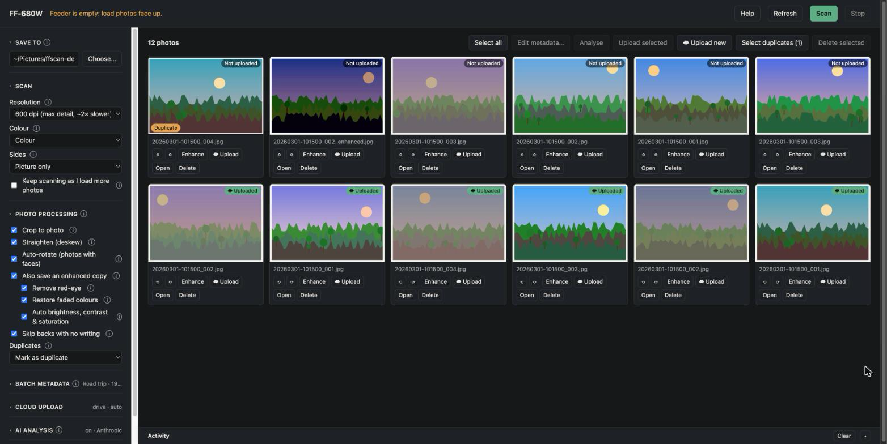
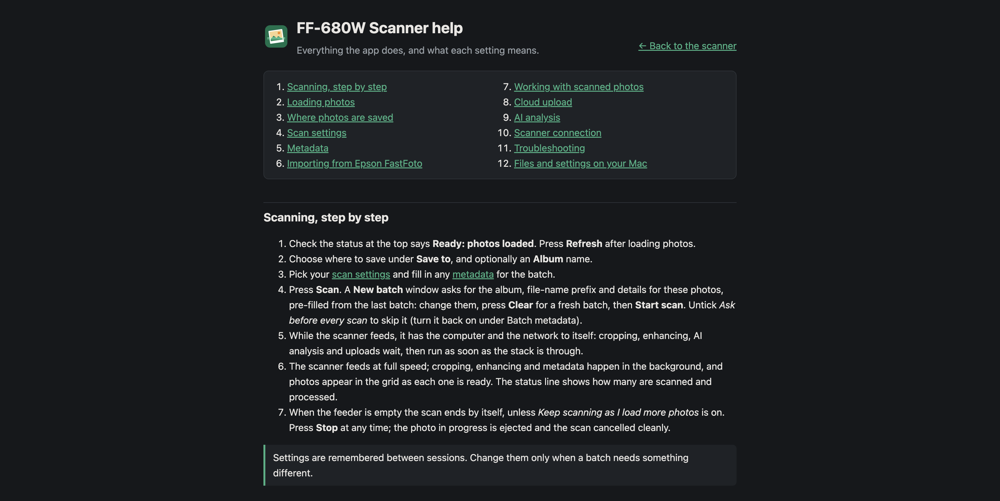

# ffscan

**An open-source replacement for Epson's FastFoto software, for the FastFoto FF-680W photo scanner on macOS.**

ffscan exists because Epson's FastFoto app kept crashing, over and over, in the middle of scanning sessions,
which made digitising a box of family photos a chore. ffscan replaces it entirely: it talks to the scanner
directly over Wi-Fi, using a protocol worked out for interoperability (see [docs/PROTOCOL.md](docs/PROTOCOL.md)),
so Epson's software doesn't need to be installed or running.

It runs as a small local web app: load a stack of prints, press **Scan**, and photos appear one by one, cropped,
organised into albums, tagged and optionally uploaded to the cloud.



## Features

- **Fast batch scanning** of up to 36 prints per stack, both sides in one pass, 50–600 dpi, colour or greyscale,
  with live thumbnails as each photo comes off the scanner.
- **USB or Wi-Fi:** plugged in with a USB cable, the scanner runs at its full mechanical speed (about 6.5 s per
  print at 600 dpi, both sides). Over Wi-Fi it is found automatically (Bonjour, with a network-scan fallback),
  whatever IP address it has, but each 600 dpi print takes about twice as long to transfer.
- **Auto-crop and straighten**, so each file is just the photo, without the grey scanner background.
- **Backs of prints:** save the picture only, the back too, or skip backs that have no writing on them.
- **Your file names and folders:** a file-name prefix with `{album}`/`{date}` (numbering never overwrites),
  and where enhanced copies go: by default each album is split into `Originals/` and `Enhanced/`.
- **Full-speed scanning:** while a stack feeds, the scanner has the computer and network to itself; cropping,
  enhancement, AI and uploads run as soon as it's through. A face-down, single-sided mode sends only the picture
  (about half the data) when the backs don't matter.
- **Adjust & preview:** brightness, contrast, saturation, warmth and sharpness sliders with a live before/after
  on one of your own photos; save as the default or apply to selected photos.
- **Picks up where it left off:** queued processing, AI analysis and uploads are kept in a small SQLite file, so
  they resume after a restart or crash.
- **Enhanced copies** (originals are always kept):
  - Remove red-eye: Apple Vision finds the eyes, and only red pixels inside them are changed.
  - Restore faded colours.
  - Auto brightness, contrast and saturation.
- **Auto-rotate without AI:** faces set the angle when there are people; otherwise Apple's on-device scene
  recognition turns a photo when it is clearly sure (12 of 14 right in testing; unsure photos stay as scanned).
- **Reads the backs of prints without AI:** handwriting, stamps and dates are read on-device and added to the
  picture's description; a written date becomes the photo's date. Paper logos and lab codes are ignored.
- **Metadata written into the files** (EXIF/IPTC/XMP): album, date taken, place, people, tags and a description,
  so Apple Photos, Google Photos and Lightroom can search and sort them.
- **AI analysis (optional):** Claude writes a caption (added to the photo's description) and tags, estimates the
  year and guesses the place, with one request per print (~2 cents with Claude Opus 5.5). It never overwrites what
  you typed, and handles rotation or backs only where the on-device methods had no answer. If the account runs
  out of credit, the queue pauses and *Analyse remaining* finishes the job after a top-up.
- **Import from Epson FastFoto:** photos already scanned with Epson's app go through the same pipeline
  (rotation, enhancement, duplicates, metadata, AI, upload), with their backs.
- **Cloud upload** to Google Drive, Google Photos, Dropbox, OneDrive or Amazon S3 (and S3-compatible services),
  set up entirely in the app. It includes a folder browser, a progress bar and an *Uploaded* badge on every photo.
- **Duplicate detection:** a visual fingerprint spots a print you've already scanned, even at another
  resolution, crop or orientation.
- **Built-in help:** a tooltip on every setting and a full help page.



## Quick start (macOS)

**Before you start: install Epson's driver.** On Epson's
[FF-680W support page](https://epson.com/Support/Scanners/FastFoto-Series/Epson-FastFoto-FF-680W/s/SPT_B11B237201?review-filter=macOS+27.x+%28Golden+Gate%29),
download and install the **Scanner Driver** and the **Epson Scan 2 Utility**. You don't need the FastFoto app.

Everything below is a one-time setup. Copy and paste each block into **Terminal**.

**1. Apple's command line tools** (includes `git` and the Swift compiler). Skip this if `xcode-select -p`
already prints a path.

```bash
xcode-select --install
```

**2. Homebrew**, the macOS package manager. Skip this if `brew --version` already works.

```bash
/bin/bash -c "$(curl -fsSL https://raw.githubusercontent.com/Homebrew/install/HEAD/install.sh)"
```

On Apple Silicon Macs, follow the two `echo … >> ~/.zprofile` / `eval …` lines Homebrew prints at the end so
that `brew` is on your PATH, then open a new Terminal window.

**3. Python and the tools ffscan uses:** exiftool writes photo metadata, rclone handles cloud uploads, and
libusb lets ffscan use the scanner over a USB cable (much faster than Wi-Fi at 600 dpi).

```bash
brew install python exiftool rclone libusb
```

**4. Download and start ffscan**

```bash
git clone https://github.com/eg7eg7/ffscan.git
cd ffscan
./run.sh
```

The first run takes about a minute. It creates a Python environment, installs the dependencies and builds
the small Apple Vision helper. Then it opens **http://localhost:8680** in your browser. Stop the app with
`Ctrl-C`; start it again any time with `./run.sh` from the `ffscan` folder.

**5. Scan**

1. Make sure the scanner is on and connected to the **same Wi-Fi** as your Mac (use Epson's setup once if it
   has never been on Wi-Fi). ffscan finds it by itself; the status at the top turns to *Ready*.
2. Load photos **face up** in the feeder.
3. Choose where to save them under **Save to**, and optionally an album name under **Batch metadata**.
4. Press **Scan**, fill in the album, file names and details for this batch in the window that opens, and press
   **Start scan**. Hover the ⓘ next to any setting for an explanation, or press **Help**.

Tick **Keep scanning as I load more photos** to work through a whole box without touching the computer.

## Run with Docker (any OS)

If you'd rather not install anything except [Docker](https://www.docker.com/products/docker-desktop/):

```bash
git clone https://github.com/eg7eg7/ffscan.git
cd ffscan
# edit docker-compose.yml: set FFSCAN_SUBNET to your network, e.g. "192.168.1" (or FFSCAN_SCANNER to the scanner's IP)
docker compose up -d
```

Open **http://localhost:8680**. Scans are saved in the `photos` folder next to `docker-compose.yml`.

The container runs everything that doesn't depend on macOS: scanning, crop, enhancement (without red-eye),
duplicates, metadata, AI analysis and uploads. Not available in Docker:

- Face-based auto-rotate and red-eye removal, which need Apple Vision.
- Automatic Bonjour discovery: set `FFSCAN_SUBNET` or `FFSCAN_SCANNER` instead.
- Browser sign-in for Google Drive, Dropbox or OneDrive. Either mount an rclone config where those accounts are
  already connected (see the comment in `docker-compose.yml`), or use Amazon S3.
- The Keychain: pass `ANTHROPIC_API_KEY` in `docker-compose.yml` for AI analysis.

**Docker Desktop on macOS:** if the app can't reach the scanner, allow Docker under *System Settings → Privacy &
Security → Local Network*. On Linux, `network_mode: host` also works and lets the app search your network by itself.

### Cloud upload

Under **Cloud upload**, press **+ Connect account…** and choose a service. Google Drive, Google Photos, Dropbox
and OneDrive sign in through your browser; Amazon S3 takes access keys in a form. Then pick a folder and tick
**Upload each photo automatically**, or use **☁ Upload new** at any time.

Uploads use [rclone](https://rclone.org), which keeps account tokens in its own config file
(`~/.config/rclone/rclone.conf`).

### AI analysis

Under **AI analysis**, paste an Anthropic API key (create one and top up credit on the
[Claude Platform dashboard](https://platform.claude.com/dashboard)) and press **Save**, then **Test**. The key is checked with Anthropic and
stored in the macOS Keychain, never in a file. Then tick **Analyse photos with Claude**. Claude on Google Vertex
AI is also supported (choose it under **Service**), if your Google Cloud project has quota for Claude models.

Photos are sent for analysis only while this option is on. Blank backs are never sent.

## Command line

The scanner library also works on its own:

```bash
.venv/bin/python -m ffscan.ff680w status           # ready / feeder empty / jam
.venv/bin/python -m ffscan.ff680w info             # model, serial, firmware
.venv/bin/python -m ffscan.ff680w scan --dpi 600 --picture-only --skip-blank-backs --out ~/Pictures/scans
.venv/bin/python -m ffscan.ff680w scan --help      # all options (--watch, --gray, --deskew, ...)
```

Or from Python:

```python
from ffscan.ff680w import FF680W

with FF680W() as scanner:                  # finds the scanner on the network
    for page in scanner.scan(dpi=300):     # yields each side as soon as it is finished
        if page.side == "B":               # side B is the picture when prints are loaded face up
            open(f"photo_{page.index:03d}.jpg", "wb").write(page.jpeg)
```

## How it works

```
 Scanner ──Wi-Fi, TCP 1865──▶ ff680w.py ──▶ app.py pipeline ──▶ your folder ──▶ rclone ──▶ cloud
 (ESC/I-2 inside "IS" packets)   │            │
                                 │            ├─ crop / straighten       (ff680w.py, Pillow)
                                 │            ├─ duplicates              (dupes.py)
                                 │            ├─ enhance, red-eye        (enhance.py, Apple Vision)
                                 │            ├─ rotate (faces)          (tools/orient.swift)
                                 │            ├─ metadata                (exiftool)
                                 │            └─ AI analysis, background (photo_ai.py, Claude)
                                 └─ the browser UI polls /api/events once a second
```

| Path | What it is |
|---|---|
| `ffscan/ff680w.py` | Scanner protocol client and command-line tool |
| `ffscan/app.py` | Web server (FastAPI) and the scan → save → process → upload pipeline |
| `ffscan/enhance.py` | Red-eye removal, faded-colour restoration, auto enhance |
| `ffscan/dupes.py` | Duplicate detection (perceptual hash, all four rotations) |
| `ffscan/photo_ai.py` | AI analysis with Claude (Anthropic API or Google Vertex AI) |
| `ffscan/cloud.py` | Cloud accounts through rclone, set up without its text interface |
| `ffscan/static/` | The single-page UI and the help page |
| `tools/orient.swift` | Apple Vision helper: face-based orientation and eye positions |
| `tests/test_ffscan.py` | Offline tests: `.venv/bin/python tests/test_ffscan.py` |
| `docs/PROTOCOL.md` | The scanner's network protocol, documented |
| `docs/ROADMAP.md` | What's done, what's next, known limitations |
| `Dockerfile`, `docker-compose.yml` | Container setup (see "Run with Docker") |
| `CLAUDE.md` | Notes for AI coding agents working on this repository |

## Where things are stored

| What | Where |
|---|---|
| Your scans | The **Save to** folder (default `~/Pictures/Scans`): one folder per album or date, with `Originals/` and `Enhanced/` inside |
| Settings, upload record, duplicate index, work queue (`jobs.db`) | `~/Library/Application Support/FF680W/` |
| Thumbnails and the last 300 untouched scans | `~/Library/Caches/FF680W/` |
| Anthropic API key | macOS Keychain, item `ff680w-anthropic` |
| Cloud account tokens | rclone's config, `~/.config/rclone/rclone.conf` |

The app listens on `127.0.0.1` only, so it isn't reachable from other devices. Environment variables
`FFSCAN_PORT`, `FFSCAN_BIND`, `FFSCAN_DATA_DIR`, `FFSCAN_CACHE_DIR`, `FFSCAN_PHOTOS_DIR`, `FFSCAN_SCANNER` and
`FFSCAN_SUBNET` change the defaults (see the top of `ffscan/app.py`).

## Troubleshooting

| Problem | What to do |
|---|---|
| *No Epson scanner found* | Check the scanner is on and its Wi-Fi light is steady, on the same network as the computer. If your network blocks discovery, enter the scanner's address under **Advanced → Address**. With Docker, set `FFSCAN_SUBNET` or `FFSCAN_SCANNER`. |
| *Feeder is empty* | Push the photos in until they stop, face up, then press **Refresh**. |
| *Paper jam* | Open the cover, remove the photo, close it, and scan again. Photos already saved are kept. |
| *Scanner refused lock* | Another app is using the scanner: quit Epson FastFoto, ScanSmart or Epson Scan 2. |
| Google refuses the Drive sign-in | rclone's shared Google sign-in is being retired. Create your own OAuth client ID (see **Help → Cloud upload**) and paste it in the connect dialog. |

## Limitations

- The full feature set needs macOS (Apple Vision, Bonjour, Keychain, folder picker); Docker runs the rest.
- Tested with the FF-680W over Wi-Fi. USB and the scanner's own Scan button aren't supported yet.
- On-device rotation leaves photos alone when it isn't sure (e.g. close-ups of foliage).

See [docs/ROADMAP.md](docs/ROADMAP.md) for planned work, and the [project board](https://github.com/users/eg7eg7/projects/5) and
[issues](https://github.com/eg7eg7/ffscan/issues) for what's being worked on.

## How it was built

The scanner protocol was reverse-engineered with the help of [REA](https://github.com/morluto/rea), a
reverse-engineering skill and MCP server for AI coding agents, used here with Claude Code. REA was used to
inventory Epson's macOS software, find the scanner's command classes and transports, and guide the
disassembly that revealed the message framing. The findings were then confirmed against a real scanner with
read-only probes. The full write-up is in [docs/PROTOCOL.md](docs/PROTOCOL.md).

## Disclaimer

ffscan is an independent project, not affiliated with or endorsed by Seiko Epson Corporation. *Epson* and
*FastFoto* are trademarks of their respective owners and are used here only to identify compatible hardware.
The protocol description was produced for interoperability; no Epson software or data is included.
Use at your own risk.

## License

[MIT](LICENSE)
